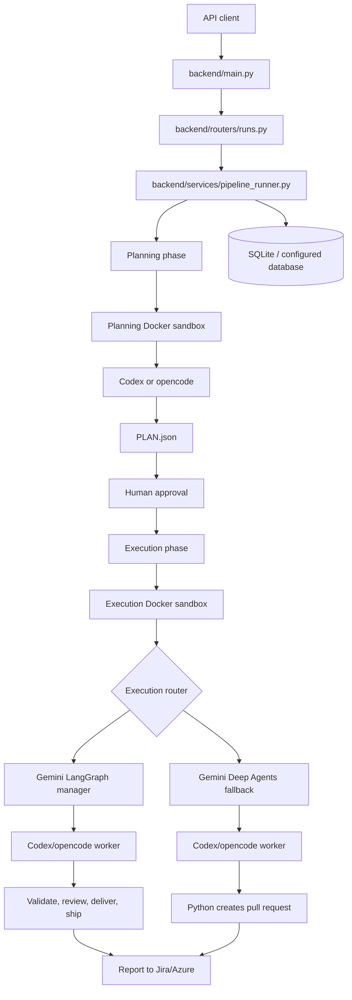

# Agentic Pipeline Architecture

This document describes the backend and agent architecture of the Agentic Pipeline project. Frontend implementation details are intentionally excluded.

## 1. System Overview

The application is a FastAPI backend that receives pipeline requests, stores state in a database, opens isolated Docker sandboxes, and coordinates Gemini with Codex or opencode to turn a Jira, Azure DevOps, or manual ticket into a code change and pull request.



## 2. Main Application Entry Point

The primary runtime entrypoint is:

```text
backend/main.py
```

Start it with:

```powershell
uvicorn backend.main:app --reload
```

At startup it:

1. Loads environment variables from `.env`.
2. Initializes the database schema.
3. Marks abandoned pipeline runs as failed.
4. Checks configured external connections.
5. Registers the API routers.

The backend is an in-process application. Pipeline phases are started with `asyncio.create_task`; there is no external job queue in the current design.

## 3. Important Folder Structure

### `backend/`

The HTTP/API layer.

- `main.py`: FastAPI application and startup lifecycle.
- `routers/`: HTTP endpoints grouped by feature.
- `services/`: long-running backend operations, especially pipeline execution.
- `schemas.py`: Pydantic request and response models.
- `deps.py`: shared backend dependencies.

The most important backend files are:

```text
backend/main.py
backend/routers/runs.py
backend/services/pipeline_runner.py
```

### `agents/pipeline_agent/`

The main ticket-to-code pipeline implementation.

- `config.py`: loads project, connection, model, engine, and sandbox settings.
- `ticket.py`: fetches tickets and renders them as Markdown.
- `runner.py`: planning, replanning, execution, streaming, and plan parsing.
- `manager.py`: Gemini LangGraph orchestration for the managed execution path.
- `agent.py`: builds the Deep Agents fallback and opens execution workspaces.
- `sandbox_runtime.py`: prepares the sandbox for each pipeline phase.
- `runs.py`: database operations for pipeline runs, artifacts, events, and costs.
- `schemas.py`: implementation-plan models and serialization.
- `pr.py`: GitHub/Azure pull-request operations.
- `credentials.py`: project and Git credential access.
- `classify.py`: ticket classification and execution budgets.
- `pause.py`: pause, resume, and cancellation controls.
- `salesforce_validator.py`: Salesforce deployment validation.

### `agents/jira_agent/`

The standalone Jira research agent and Jira integration layer.

It contains:

- Jira REST operations.
- Jira connection configuration.
- OAuth and MCP integration.
- Atlassian tools.
- A Gemini `create_deep_agent` implementation.
- A command-line research runner.

This agent is separate from the main pipeline manager, although the pipeline reuses some Jira connection and REST helpers.

### `agents/azure_agent/`

Azure DevOps integration.

It handles Azure connections, work items, Git repositories, REST requests, comments, and authentication.

### `agents/skills/`

Skill catalog and project-memory services.

It manages skill definitions, versions, imports, project assignments, installation, and memory injection into sandboxes.

### `database/`

SQLAlchemy database layer.

- `session.py`: database engine, sessions, schema initialization, and SQLite settings.
- `base.py`: SQLAlchemy declarative base.
- `models/`: database entities such as projects, pipeline runs, agent runs, artifacts, cost logs, connections, skills, and tickets.

The default database is:

```text
agent_factory.db
```

### `sandbox/`

Docker-backed isolated execution environment.

- `manager.py`: starts containers, clones repositories, executes commands, runs coding engines, handles credentials, and creates pull requests.
- `Dockerfile`: generic sandbox image.
- `salesforce.Dockerfile`: Salesforce-enabled sandbox image.
- `config.toml`: default Codex configuration overwritten at runtime.

### `tools/`

Tools exposed to agent orchestrators.

- `sandbox_tools.py`: command execution, repository cloning, Codex, and opencode tools.
- `file_tools.py`: sandbox file read/write tools.

These tools are bound to one existing `SandboxManager`, so all operations use the same container filesystem.

### `skills/`

Local skill content and supporting skill files.

### `skill_catalog/`

Catalog sources for built-in or imported skill packages, such as Salesforce development skills.

### `storage/`

Persistent local storage for skill packages and project-memory content. The database stores metadata and this directory stores package data.

### `tests/`

Automated tests for API behavior, database behavior, routing, credentials, skills, sandbox logic, Salesforce validation, pipeline concurrency, and planning/replanning.

### `scripts/`

Operational utilities such as secret encryption and history cleanup.

### `docs/`

Architecture, planning, and design documentation.

### `ref/`

Reference material and design exports. It is not part of the application runtime.

## 4. Pipeline Flow

### Step 1: Create a Run

A client sends:

```text
POST /api/pipeline-runs
```

`backend/routers/runs.py`:

1. Finds the project.
2. Confirms that a Jira, Azure, ticket-group, or manual ticket exists.
3. Creates a `PipelineRun` database record.
4. Starts the planning phase through `pipeline_runner.py`.

### Step 2: Fetch and Prepare the Ticket

The pipeline loads the ticket from one of these sources:

- Jira REST API.
- Azure DevOps REST API.
- Imported ticket group.
- Manual work item.

`agents/pipeline_agent/ticket.py` converts the ticket into Markdown.

The Markdown is written into the sandbox as:

```text
TICKET.md
```

This file contains the ticket requirements, acceptance criteria, comments, subtasks, epic context, and attachments.

### Step 3: Planning

The planning phase is implemented by `agents/pipeline_agent/runner.py`.

```text
Fetch ticket
    -> Open planning sandbox
    -> Clone repository
    -> Configure Git and credentials
    -> Install planning skills and memory
    -> Write TICKET.md
    -> Run Codex or opencode
    -> Read PLAN.json
    -> Validate the plan schema
    -> Store plan and transcript in the database
```

The planning agent must write `PLAN.json` and must not modify source code, commit, push, or create a pull request.

After planning, the run enters:

```text
awaiting_approval
```

### Step 4: Human Approval

The client sends:

```text
POST /api/pipeline-runs/{run_id}/approval
```

Possible actions:

- `reject`: stop the run.
- `revise`: start a replanning phase using reviewer feedback.
- `approve`: start execution using the approved plan.

Replanning creates another planning sandbox, seeds the existing `PLAN.json`, and asks Codex/opencode to revise it.

### Step 5: Open the Execution Sandbox

On approval, `pipeline_runner.py` opens an execution workspace through:

```text
agents/pipeline_agent/agent.py
agents/pipeline_agent/sandbox_runtime.py
```

The execution sandbox contains:

- The cloned repository.
- A fresh `feature/<TICKET>` branch.
- `TICKET.md`.
- The approved implementation plan.
- Project skills.
- Project memory.
- Git credentials.
- Salesforce authentication when configured.
- Node/npm tooling when needed.

The container remains alive for the entire execution phase, including retries, validation, review, deployment, and reporting.

## 5. Execution Routing

The execution path is selected by `manager_enabled()` in `agents/pipeline_agent/manager.py`.

Default behavior:

```text
Salesforce project + Gemini key -> custom Gemini LangGraph manager
Other project types             -> Deep Agents fallback
```

Environment overrides:

```text
PIPELINE_AGENT_MANAGER=1  # force manager
PIPELINE_AGENT_MANAGER=0  # disable manager
```

## 6. Managed Execution Path

The managed path is implemented by:

```text
agents/pipeline_agent/manager.py
```

It uses:

```text
LangGraph StateGraph
ChatGoogleGenerativeAI
Custom manager tools
```

Gemini is the manager, not the code writer.

The manager can call:

```text
inspect_context
 delegate_worker
 validate
 review
 deliver
 ship
 report_to_ticket
```

The normal flow is:

```text
Gemini reads ticket and plan
    -> delegate_worker
    -> Codex/opencode edits the repository
    -> worker commits and pushes feature branch
    -> validate branch and deployment readiness
    -> review committed diff
    -> deliver pull request
    -> ship to Salesforce and merge, when enabled
    -> report result to Jira/Azure
```

Validation can reopen delegation when the branch has errors, no commits, or no implementation. A failed review can reopen delegation once. Retry limits prevent endless loops.

## 7. Deep Agents Fallback

The fallback is implemented in:

```text
agents/pipeline_agent/agent.py
```

It creates a `deepagents.create_deep_agent()` using Gemini and tools from:

```text
 tools/sandbox_tools.py
 tools/file_tools.py
```

For Jira projects it can also include Atlassian MCP tools.

In this path:

```text
Gemini Deep Agent
    -> reads the approved plan
    -> uses sandbox/file tools
    -> invokes Codex or opencode
    -> observes the result
    -> returns an execution summary
    -> Python opens the pull request
```

The fallback is older and less structured than the custom LangGraph manager. The custom manager owns explicit validation, review, delivery, deployment, and reporting tools.

A second, standalone Deep Agents implementation exists in:

```text
agents/jira_agent/agent.py
```

That agent is used for Jira research and Atlassian MCP interaction rather than the main Salesforce delivery workflow.

## 8. Model Responsibilities

### Gemini

Gemini is used for orchestration and decision-making.

It can:

- Interpret the approved plan.
- Assign work to the coding worker.
- Decide whether validation passed.
- Review the implementation result.
- Decide whether to retry, deliver, deploy, or block.
- Write the final ticket report.

The model is configured with:

```text
PIPELINE_AGENT_MODEL
a default of gemini-2.5-flash
GOOGLE_API_KEY or GEMINI_API_KEY
```

### Codex or opencode

Codex/opencode is the implementation engine inside the sandbox.

It:

- Reads `TICKET.md` and the approved plan.
- Inspects and edits source code.
- Runs relevant tests and checks.
- Commits changes.
- Pushes the feature branch.

It is configured with variables such as:

```text
PIPELINE_AGENT_ENGINE
CODEX_PLANNING_MODEL
CODEX_EXECUTION_MODEL
CODEX_REVIEW_MODEL
CODEX_REASONING_EFFORT
```

### Docker sandbox

The sandbox is the isolated runtime, not an AI model.

It protects the host application from direct repository commands and provides the tools, credentials, Salesforce CLI, Git configuration, and filesystem required by the coding agent.

## 9. Delivery and Persistence

After execution:

1. The feature branch is checked.
2. The branch is validated.
3. The committed diff is reviewed.
4. A pull request is opened through GitHub or Azure DevOps.
5. Salesforce changes may be deployed and the pull request may be merged.
6. A report is posted to the ticket source.
7. Artifacts are stored in the database.
8. Cost and token usage are stored.
9. The sandbox container is destroyed.

Persisted objects include:

- `PipelineRun`: overall run status.
- `AgentRun`: planning or execution phase.
- `AgentRunEvent`: live progress events.
- `Artifact`: plan, transcript, summary, comment, or PR link.
- `CostLog`: model usage and cost.

## 10. Files to Read First

For understanding the complete application flow, read these files in order:

1. `backend/main.py`
2. `backend/routers/runs.py`
3. `backend/services/pipeline_runner.py`
4. `agents/pipeline_agent/runner.py`
5. `agents/pipeline_agent/manager.py`
6. `agents/pipeline_agent/sandbox_runtime.py`
7. `sandbox/manager.py`
8. `database/session.py`

The central idea is:

```text
FastAPI owns the request.
The pipeline runner owns the phase lifecycle.
Gemini owns orchestration and decisions.
Codex/opencode owns implementation.
Docker owns isolation.
The database owns state, artifacts, events, and costs.
```